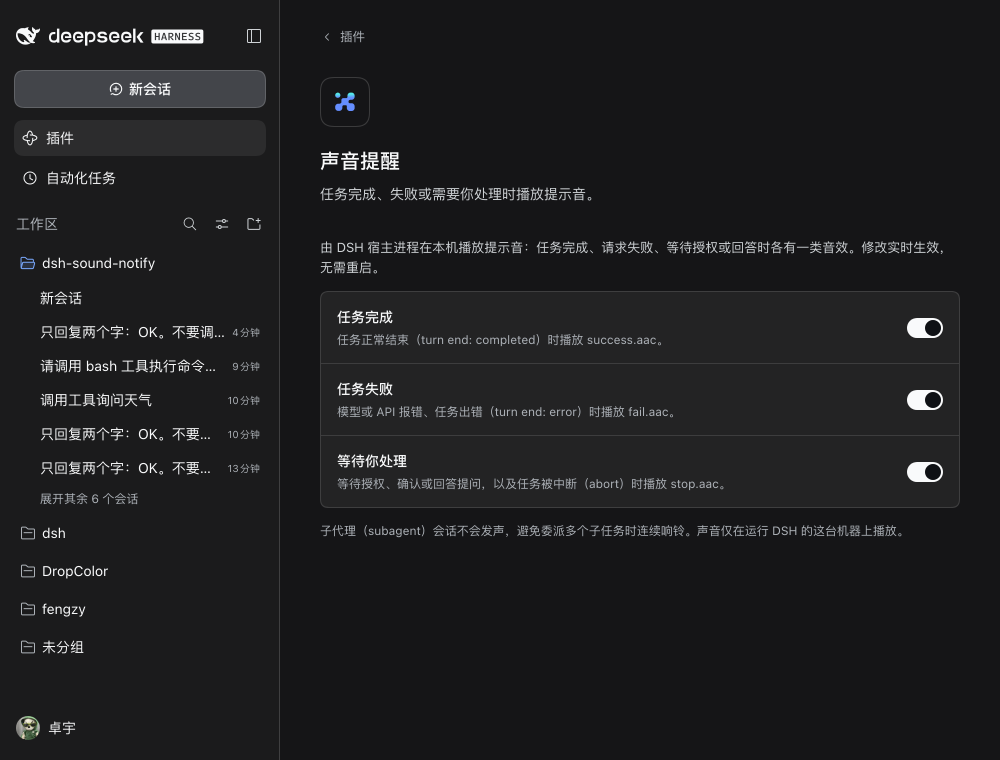

# dsh-sound-notify

**English** | [简体中文](README.zh.md)

[](https://github.com/hifengzy/dsh-sound-notify/actions/workflows/ci.yml)
[](LICENSE)
[](https://github.com/topics/dsh-plugin)

Sound notifications for **DeepSeek Harness (DSH)**. When a DSH task finishes, fails, or stops to wait for you, this plugin plays a short sound on the machine running DSH — and gives you a switch for each category.



## Why

DSH sessions are long-running. Without a sound, you keep alt-tabbing back to the window to check whether the agent is done. This plugin makes "it stopped" audible:

| Event | Trigger | Sound |
| --- | --- | --- |
| Task completed | turn ends with `completed` | `sounds/success.aac` |
| Task failed | turn ends with `error` / `max-tokens`, or an API request failed and a retry was scheduled (`llm/retry`) | `sounds/fail.aac` |
| Waiting for you | approval prompt (`approval/asked`), `ask_user_question`, turn aborted / blocked / interrupted | `sounds/stop.aac` |

Playback happens in the **DSH host process** with the OS audio player (macOS `afplay`, Linux `paplay`), so it works even when the browser tab is backgrounded, minimized, or closed. The sound plays on the machine that runs DSH.

## Features

- **Three independent switches**, all enabled by default, stored in DSH settings and applied live — no restart needed.
- **Quiet where it should be**:
  - subagent sessions are silent, so one delegated parent task does not ring for every child turn;
  - a 500 ms grace period after `idle` cancels the alert when queued input or an automatic continuation immediately starts again;
  - one failure sound per turn even across automatic retries;
  - 700 ms cooldown between two sounds of the same category.
- **Works with current DSH**: settings render as a card in the 0.2.x **Plugins** page, with an automatic fallback to the 0.1.x settings section.
- **No build step**: plain ESM host code plus a hand-written `window.__ModuleLoader__` client bundle.

## Install

### Desktop app (Electron-owned `desktop` profile)

The `dsh` CLI refuses to manage the reserved `desktop` profile, so use the bundled script (idempotent, backs up the patch file):

```bash
git clone https://github.com/hifengzy/dsh-sound-notify.git
cd dsh-sound-notify
./scripts/install-desktop.sh
```

Then **restart the DSH desktop app**. The desktop host does not hot-mount a newly added profile plugin, so the first activation needs a restart.

After restarting: **Plugins → Sound notifications** (sidebar Plugins page) shows the three switches; finish any task to hear `success.aac`.

<details>
<summary>Manual desktop install (what the script does)</summary>

```bash
DSH_HOME="${DSH_HOME:-$HOME/.dsh}"
PROFILE="$DSH_HOME/profiles/desktop"
DEST="$PROFILE/node_modules/dsh-sound-notify"

cp "$PROFILE/cordis.patch.yml" "$PROFILE/cordis.patch.yml.bak.$(date +%s)"
mkdir -p "$DEST" && rm -rf "${DEST:?}"/*
cp -R lib sounds package.json cordis.patch.yml README.md README.zh.md LICENSE "$DEST"/

grep -q "id: sound-notify" "$PROFILE/cordis.patch.yml" || cat >> "$PROFILE/cordis.patch.yml" <<'YAML'

- insert:
    - id: sound-notify
      name: 'dsh-sound-notify'
YAML
```

</details>

### CLI-managed profiles (`web`, `headless`, custom profiles)

Pick whichever source you prefer — all of them are the same plugin:

```bash
# directly from GitHub (works today)
dsh plugin --profile web add github:hifengzy/dsh-sound-notify

# prebuilt tarball attached to the latest GitHub Release (works today)
dsh plugin --profile web add https://github.com/hifengzy/dsh-sound-notify/releases/latest/download/dsh-sound-notify.tgz

# npm (after the package is published; see docs/PUBLISHING.md)
dsh plugin --profile web add dsh-sound-notify
```

Restart the profile's app after installing. `dsh plugin add` installs the package into the profile and appends `dsh-sound-notify` to `dsh.profile.bundles`; the package's own `cordis.patch.yml` mounts the plugin row.

For a custom profile, replace `web` with its name. Check that the plugin composed correctly:

```bash
dsh --profile web --dump-config | grep -A2 sound-notify
```

## Settings

**DSH 0.2.x**: sidebar **Plugins → Sound notifications**. The values live in the plugin entry's `config` in the profile patch (`$DSH_HOME/profiles/<profile>/cordis.patch.yml`) and are read live on every notification.

**DSH 0.1.x**: **Settings → Sound notifications** (registered `sound-notify` settings namespace in `$DSH_HOME/settings.yaml`).

| Switch | Default | When off |
| --- | --- | --- |
| Task completed | on | `success: false` — no completion sound |
| Task failed | on | `failure: false` — no failure/API-error sound |
| Waiting for you | on | `waiting: false` — no approval/question/abort sound |

## Debugging

The desktop host has no terminal. Set `DSH_SOUND_NOTIFY_LOG` **before launching DSH** to get a line for every decision and playback attempt:

```bash
DSH_SOUND_NOTIFY_LOG=/tmp/dsh-sound-notify.log dsh web
```

```text
2026-10-19T17:21:05.071Z [sound-notify] notifyIdle reason=completed kind=success
2026-10-19T17:21:05.071Z [sound-notify] enabled success = false (config)
2026-10-19T17:21:05.071Z [sound-notify] muted success
```

Playback failures (missing file, no audio player) are logged too instead of failing silently.

## Platform support

| Platform | Player | Status |
| --- | --- | --- |
| macOS | `afplay` | verified |
| Linux | `paplay` (PulseAudio/PipeWire) | requires `paplay` |
| Windows | — | no AAC CLI player; logs a diagnostic and stays silent |

## Compatibility

| DSH | Settings surface | Install |
| --- | --- | --- |
| 0.2.x (current, incl. desktop 0.2.1-rc.2) | Plugins page card over volatile plugin `Config` | `dsh plugin add` / GitHub / tarball / desktop script |
| 0.1.x | dedicated settings section over a registered namespace | `dsh plugin add` / GitHub |

The host half only observes the event bus (`session/event`, `agent/status`, `user-questions/request`) and never edits the session log or influences approval decisions (the question waterfall listener always calls `next()`).

## Development

```bash
npm install
npm test        # 31 node:test cases
npm run verify  # packaging self-check (manifest, files, AAC magic, client bundle)
npm pack        # prebuilt tarball for releases
```

CI (`.github/workflows/ci.yml`) runs the test suite on Node 20/22/24, verifies the package, and performs a real install smoke test against the latest published `@deepseek-ai/dsh`: it creates a web profile, installs the packed tarball with `dsh plugin add`, and asserts the plugin composes into the profile tree.

Tagging `v*` runs `.github/workflows/release.yml`, which attaches the tarball to a GitHub Release and publishes to npm when an `NPM_TOKEN` secret is configured. See [docs/PUBLISHING.md](docs/PUBLISHING.md) for the npm-token and catalog-submission steps.

## Community

The plugin is prepared for the [awesome-dsh-plugin](https://github.com/awesome-dsh-plugin/awesome-dsh-plugin) catalog (`category: notify`), which is what the DSH plugin market (`dshmarket`) reads; `awesome-dsh-plugin.yml` is ready in [`community/`](community/) and the submission helper is `scripts/submit-to-catalog.sh` (the catalog requires the repository to be at least 1 day old). Once merged, searching for “sound” / “notification” in DSH finds it. Repo topics: `dsh-plugin`, `deepseek-harness`, `dsh`.

## License

MIT © 2026 fengzhuoyu — see [LICENSE](LICENSE). The bundled sound clips are part of this repository and shipped under the same license.
